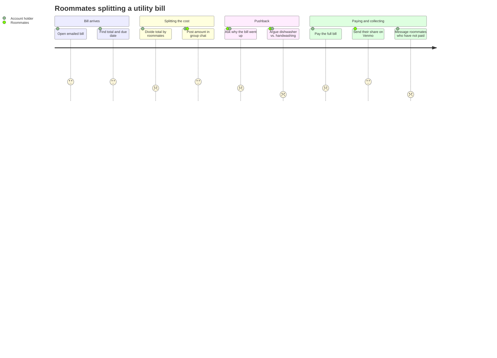

# Requirements: FairShare (roommate utility bill tracker)

> **Evidence note:** These requirements come from one practice interview (Interview 1), recorded as summary notes, not quotes. Anything the notes don't support is marked **(assumption)** and should be checked in later interviews.

## Problem statement
College roommates who share an apartment have trouble keeping track of their shared utility bill (Interview 1). The bill changes each month, so each person's share changes too ("Cost varies since utilities are split," Interview 1). That makes it hard to tell what anyone owes. Roommates also disagree about the habits that drive the bill, such as whether the dishwasher or handwashing uses less (Interview 1), and the interviewee wants the household to be "more collaborative rather than combative" (Interview 1). This comes up at least once a month, every time a bill arrives **(assumption: monthly billing)**. The cost is friction between roommates and confusion about money. The notes give no dollar amounts or time spent, so we can't size the cost yet.

## Job to be done
When I'm **splitting a utility bill with my roommates**, I want to **keep track of the bill and who owes what in one place we can all see**, so I can **stay collaborative with them instead of combative**.

## Users and stakeholders
| Role | Who (initials or title) | What they need from the system |
|---|---|---|
| Primary user | Interviewee 1: roommate who tracks the shared utility bill | Record the bill, see each person's share, and know who has paid without having to chase anyone |
| Primary user | The other roommates in the household | See the same numbers, see why their share changed, and know what they owe and when |
| Stakeholder (affected) | Utility account holder (the roommate whose name is on the bill) **(assumption)** | Be paid back on time; avoid carrying everyone's share or a late fee |
| Stakeholder (affected) | Landlord / utility provider **(assumption)** | Bill paid in full and on time; not a user of the system |

**Not for:** landlords or property managers billing tenants, families with one person paying everything, and general expense splitting (groceries, trips, rent). The MVP covers shared **utility** bills only.

## Persona
**Jordan, 20, junior, lives with three roommates in an off-campus apartment** *(composite, based on Interview 1 plus assumptions)*. Jordan ends up tracking the utility bill because nobody else does. **Goals:** split the bill fairly, get paid back without nagging, and keep the peace at home. **Frustrations:** the total changes every month, so the split has to be redone each time. Roommates question the amount and argue about whose habits (dishwasher vs. handwashing) raised it, which makes Jordan feel like the bad guy. **Current tools (assumption):** the utility's emailed bill, a group chat, a calculator, and Venmo.

## Current process (as-is)
*The interview notes say only that "people have different solutions on how to combat it." They don't say what those solutions are, so the steps below are an **assumed** process to confirm in the next interview.*

1. The utility bill is emailed to the roommate whose name is on the account.
2. That roommate opens the bill and notes the total and due date.
3. They divide the total by the number of roommates, usually by hand or with a phone calculator.
4. They post the amount in the household group chat.
5. Roommates ask why the bill is higher than last month, and the conversation can turn into blame over usage (e.g., dishwasher vs. handwashing).
6. The account holder pays the full bill.
7. Roommates send their share through Venmo or a similar app, on their own schedule.
8. The account holder keeps track of who has paid, from memory or by scrolling through Venmo, and reminds anyone who hasn't.

## Journey map

## Functional requirements
| ID | The system shall... | Priority (Must / Should / Could / Won't) | Source |
|---|---|---|---|
| FR-1 | let a user enter a utility bill (type, total, billing period, due date) | Must | Interview 1: "Problems keeping track of utility bill" |
| FR-2 | calculate each roommate's share automatically, split evenly by default | Must | Interview 1: "Cost varies since utilities are split" |
| FR-3 | show every roommate in the household the same bill, shares, and due date | Must | Interview 1: tracking problem; wants "collaborative rather than combative" |
| FR-4 | let roommates mark their share as paid and show everyone who has and hasn't paid | Must | Interview 1: "Problems keeping track of utility bill" |
| FR-5 | remind roommates who haven't paid before the due date, so no one has to nag | Should | Interview 1: wants less combative interactions (assumption that reminders cause friction today) |
| FR-6 | show how this month's total and each share compare with last month's | Should | Interview 1: "Cost varies since utilities are split" |
| FR-7 | support uneven splits (e.g., a roommate away for part of the month) | Could | Interview 1: varying cost (assumption) |
| FR-8 | give neutral, sourced tips on reducing usage (e.g., dishwasher vs. handwashing) | Could | Interview 1: "Friend thinks dishwasher over handwashing saves more" |
| FR-9 | send or hold money between roommates inside the app | Won't | Adds payment and regulatory complexity; roommates already have Venmo or Zelle (assumption) |
| FR-10 | import bills automatically from utility provider accounts | Won't | No confirmed data or API access; manual entry is enough to test the idea |

## Non-functional requirements
| ID | Category (usability, security, performance, privacy, cost) | Requirement | Source |
|---|---|---|---|
| NFR-1 | Privacy | Only invited members of a household can see that household's bills and payment status. | Bills show where roommates live and what they owe (team decision) |
| NFR-2 | Security | The system shall not ask for or store bank logins or utility account passwords. | Follows from FR-9 and FR-10 being Won't |
| NFR-3 | Usability | A user can enter a new bill and share it with the household in under 1 minute on a phone. | Interview 1: tracking is a hassle (assumption on target) |
| NFR-4 | Usability | Shares, reminders, and comparisons use neutral wording that never singles out or blames a roommate. | Interview 1: "collaborative rather than combative" |
| NFR-5 | Cost | Free for roommates to use; no roommate has to pay for the others to join. | Assumption: students are price-sensitive; to test |
| NFR-6 | Performance | Changes (a new bill, a payment marked) show up for all roommates within 5 seconds. | Needed for FR-3 and FR-4 to feel shared (team decision) |

## Riskiest assumption
**The friction comes from not having one shared, visible record of the bill, so if everyone can see the same numbers, roommates will use it and fight less.** If the real cause is something a tracker can't fix (one roommate who won't pay, or a disagreement about whose habits cost more), then FairShare is pointless. It is also pointless if only the person tracking the bill ever opens it.

**How we'll test it:**
1. **More interviews (3–5 roommates, including people who don't manage the bill).** Ask: "Walk me through the last time you split a utility bill, step by step" and "Tell me about the last disagreement about the bill. What happened?" Check whether the fights are about *not knowing the numbers* or about *fairness of usage*.
2. **Concierge test (2 billing cycles).** With Interviewee 1's household, set up a shared Google Sheet showing the bill, each share, last month's comparison, and a paid/unpaid column. Interviewee 1 posts the link in the group chat each month.
   - **Pass:** every roommate opens the sheet or marks their payment at least once per cycle, and the interviewee reports fewer questions or arguments about the bill.
   - **Fail:** only the interviewee uses it, or the arguments continue unchanged.

## MVP scope
**In:** FR-1 (enter a bill), FR-2 (automatic even split), FR-3 (shared household view), FR-4 (paid/unpaid tracking), plus NFR-1 through NFR-6.

**Out:**
- **FR-5 reminders and FR-6 month-to-month comparison (Should):** useful, but not needed to test the riskiest assumption. Add them if the concierge test shows people want them.
- **FR-7 uneven splits and FR-8 usage tips (Could):** the interview gave only weak evidence for them, and FR-8 could start the very arguments we're trying to reduce.
- **FR-9 in-app payments (Won't):** regulatory and security cost, and Venmo or Zelle already handles it.
- **FR-10 automatic bill import (Won't):** no confirmed access to utility data, and manual entry takes under a minute.
- **Expenses other than utilities (rent, groceries):** outside the job to be done. Other apps already cover them.
