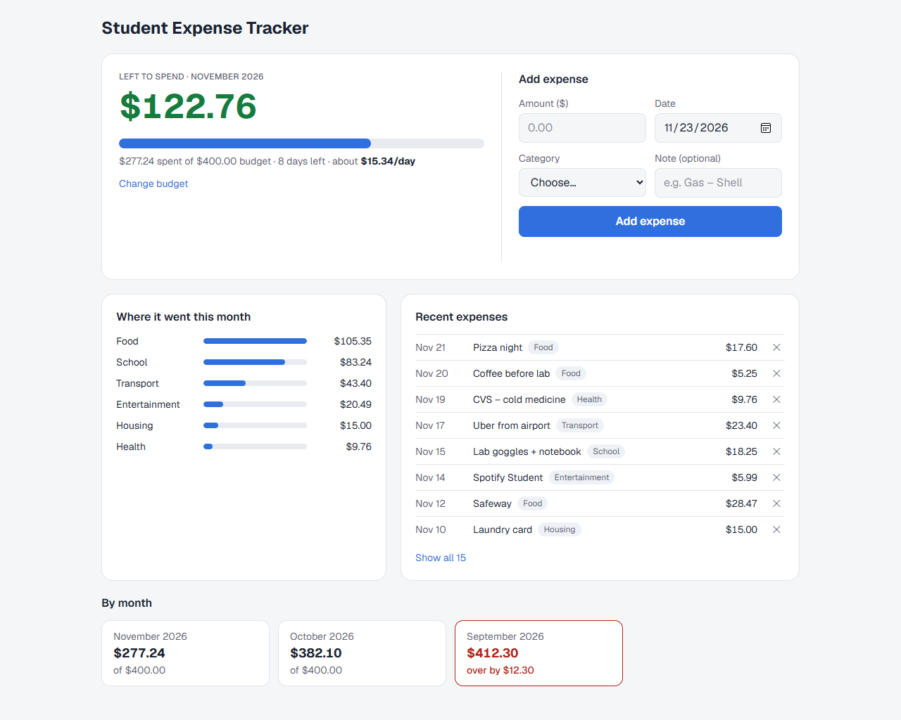

# Lab 4: Student Expense Tracker

A web app for college students who live on a fixed amount of money each month. They record each
expense with its date, amount and category, see spending grouped by month, and always know how
much of their monthly budget is left. The app won't save an expense that would push them past it.

Built with **Next.js 16 (TypeScript) + Tailwind CSS**. v1 stores data in the browser
(`localStorage`); a real database comes in Lab 6.



## What it does

| Story | Acceptance criterion | How the app meets it |
|---|---|---|
| **S1** Record an expense | Clicking **Add expense** records the date and amount and shows the category | Expense is saved and the message says *"Recorded $31.20 on Nov 22 under Transport."*; it appears in the list with its category |
| **S2** Stay within a monthly budget | An expense that fits is subtracted and the new budget is shown | *"New budget: $91.56 left."*, and the big "left to spend" number updates |
| | An expense over what's left is rejected | *"Enter an amount under budget. You have $200.00 left…"* (budget $200: $200 ok, $201 rejected) |
| | The budget turns red when nothing is left | The amount, progress bar and month card turn red |

It also shows spending by category for the month, recent expenses (with delete), and one card per
month that shows whether that month went over budget. It works on phones and in dark mode.

## Run it

```bash
cd app
npm install
npm run dev        # open http://localhost:3000
```

## Test it

```bash
cd app
npm test           # 44 tests: logic + full-screen tests for every acceptance criterion
npm run lint
npm run typecheck
npm run build
```

## What's in this folder

| Path | What it is |
|---|---|
| [`app/`](app/) | **The v1 app** (Next.js). See [`app/README.md`](app/README.md) for where the code lives |
| [`specs/spec.md`](specs/spec.md) | v1 spec: intent, stories, data, decisions, what's out of scope, open questions |
| [`specs/v1-tasks.md`](specs/v1-tasks.md) | The 22-task build plan, each task tied to a story and acceptance criterion |
| [`specs/user-stories.md`](specs/user-stories.md) | User stories |
| [`specs/add-expense-flow.md`](specs/add-expense-flow.md) | Add-expense flowchart with the budget check |
| [`design/mockups/`](design/mockups/) | Three throwaway mockups (A: budget dashboard, **chosen**; B: phone quick-log; C: calendar review) |
| [`prototype/`](prototype/) | First plain HTML/JS prototype, kept for reference (`prototype/index.html`) |
| [`design/screenshots/`](design/screenshots/) | Screenshots of the app at desktop and phone size |
| [`reflection.md`](reflection.md) | Lab reflection |

## How it was built

1. Wrote the user story (S1) and the add-expense flowchart (S2).
2. Made a quick plain-JS prototype to try the rules out.
3. Designed three different mockups of the main screen and picked **A** (the budget comes first).
4. Wrote the v1 spec, then a plan of 22 small tasks, each tied to a story and acceptance criterion.
5. Built the app in `app/`: the logic and its tests first, then the screen, then checked it in a real browser
   at desktop and phone sizes.
